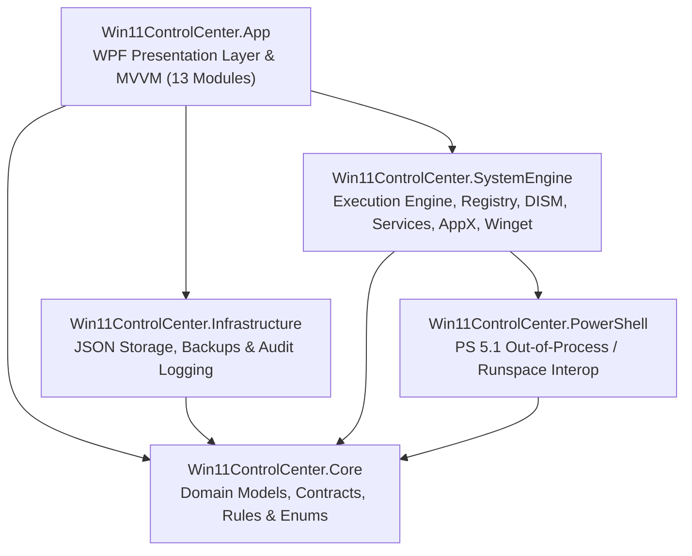
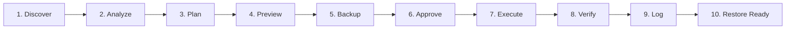

# Win11 Control Center — Architecture Specification

## 1. Executive Overview

**Win11 Control Center** is a modular, production-grade Windows 11 system management, optimization, debloater, and governance desktop application engineered in C# and .NET 10 LTS with WPF, MVVM architecture, and a hardened administrative execution engine.

Unlike ad-hoc debloater scripts, Win11 Control Center adheres to foundational systems engineering principles:
1. **Safety before performance**: System stability and integrity strictly supersede aggressive tuning.
2. **Reversibility before convenience**: Every mutable action captures a pre-change state and supplies an automated rollback mechanism whenever technically feasible.
3. **Transparency before automation**: No silent changes. All operations produce a structured, human-readable plan prior to execution.
4. **User consent before modification**: Explicit user approval is required for all state transitions.
5. **Measurable optimization**: All reported metrics and optimization candidates are grounded in genuine Windows APIs.
6. **Modular architecture**: Clean separation of presentation, domain logic, persistence, low-level system interop, and PowerShell management.

---

## 2. High-Level System Architecture

The solution is divided into strictly decoupled layers:

### Layer Responsibilities

1. **`Win11ControlCenter.Core`**:
   - **Pure Domain Models**: `ApplicationPackage`, `SoftwarePackageItem`, `WindowsServiceItem`, `StartupEntry`, `PrivacyTweak`, `OperationPlan`, `OperationItem`, `SystemInfo`, `BackupMetadata`, `PortableMachineProfile`.
   - **Domain Rules & Safety Shields**: `ProtectedPackages` (26 exact matches + 6 prefixes + substring guards), `CoreWindowsServices` (31 blacklisted Windows core services), `SafetyValidator` (registry hive and directory blacklist validation).
   - **Abstractions and Interfaces**: `ISystemDiscoveryService`, `IPackageManager`, `IWingetService`, `IStartupManager`, `IServiceManager`, `IPrivacyService`, `IOptimizationService`, `ICleanupService`, `IGamingService`, `ITweakEngineService`, `IRestoreService`, `ILoggingService`, `IOperationExecutor`.
   - **Zero external dependencies**: Contains only standard .NET primitives.

2. **`Win11ControlCenter.Infrastructure`**:
   - Local JSON storage for user settings (`settings.json`) and custom registry tweaks (`custom_tweaks.json`).
   - Structured JSONL audit logging (`audit.jsonl`).
   - Backup folder management (`Backups/YYYY-MM-DD_HH-mm-ss/`).
   - Emergency `.reg` rollback generator (`pre_apply_rollback.reg`).

3. **`Win11ControlCenter.SystemEngine`**:
   - Direct Windows API interop:
     - Registry (`Microsoft.Win32.RegistryKey`)
     - Service Control Manager (`System.ServiceProcess.ServiceController`)
     - Shell & Storage APIs (`SHQueryRecycleBin`, `SHEmptyRecycleBin`, `GlobalMemoryStatusEx`, `DriveInfo`)
     - Performance Counters / WMI
     - Official Windows Package Manager (`winget.exe` process runner with regex ID sanitization)
   - The **Safe Execution Engine** implementing the 10-step operation workflow.
   - Handlers for typed execution: `PackageRemovalOperationHandler`, `ServiceOperationHandler`, `RegistryOperationHandler`, `StartupOperationHandler`, `CleanupOperationHandler`.
   - Dry-run simulation, precondition checks, and postcondition verification.

4. **`Win11ControlCenter.PowerShell`**:
   - Windows PowerShell 5.1 hosted runspaces or out-of-process isolation for operations requiring PowerShell cmdlets (e.g., `Get-AppxPackage`, `Remove-AppxPackage`, `Get-AppxProvisionedPackage`, `Checkpoint-Computer`).
   - Strictly parameterized execution with allow-listed commands. **Never** allows arbitrary script concatenation or unvetted JSON execution.

5. **`Win11ControlCenter.App`**:
   - WPF application targeting Windows 11 x64.
   - MVVM architecture with `CommunityToolkit.Mvvm` (`ObservableProperty`, `RelayCommand`).
   - Dependency Injection using `Microsoft.Extensions.DependencyInjection` in `App.xaml.cs`.
   - Fluent Windows 11 styling with runtime Dark/Light mode theme switching (`ThemeService`).
   - 13 distinct module views with zero system manipulation logic in code-behind or ViewModels.

---

## 3. Dependency Injection Architecture

All services and ViewModels are wired as singletons or transients in `App.xaml.cs`:

| Interface | Implementation | Lifetime | Role |
|:---|:---|:---:|:---|
| `ISystemDiscoveryService` | `SystemDiscoveryService` | Singleton | Hardware, OS, and system telemetry discovery |
| `IPackageManager` | `PackageManager` | Singleton | AppX, MSIX, Provisioned package enumeration & removal |
| `IWingetService` | `WingetService` | Singleton | Winget package catalog, discovery, and batch installation |
| `IStartupManager` | `StartupManager` | Singleton | Startup entries auditing and non-destructive toggling |
| `IServiceManager` | `ServiceManager` | Singleton | Windows Services inventory, dependency graph, startup types |
| `IPrivacyService` | `PrivacyService` | Singleton | Windows privacy and telemetry configuration |
| `IOptimizationService` | `OptimizationService` | Singleton | Windows usability tweaks and optimization profiles |
| `ICleanupService` | `CleanupService` | Singleton | Safe temporary storage scanning and recycling |
| `IGamingService` | `GamingService` | Singleton | GameDVR, GPU scheduling, and power scheme alignment |
| `ITweakEngineService` | `TweakEngineService` | Singleton | Custom registry tweaks validation and persistence |
| `IRestoreService` | `RestoreService` | Singleton | Backup snapshots and restore point orchestration |
| `ILoggingService` | `LoggingService` | Singleton | Persistent JSONL audit logging |
| `ISettingsStorage` | `SettingsStorage` | Singleton | Application settings storage |
| `IThemeService` | `ThemeService` | Singleton | Runtime Fluent Dark/Light theme switching |

---

## 4. The 10-Step Safe Execution Engine

Every state-modifying action in Win11 Control Center passes through a unified execution pipeline:

### Pipeline Definitions:
1. **Discover**: Read-only capture of current Windows state (registry values, installed package status, service startup type, etc.).
2. **Analyze**: Verify system compatibility, policy restrictions (MDM/GPO/Domain), edition support, and safety rules. Reject protected components.
3. **Plan**: Build an immutable `OperationPlan` containing discrete `OperationItem` objects with estimated risk, prerequisites, and expected outcome.
4. **Preview**: Render the plan to the user with exact keys, paths, and consequences clearly highlighted.
5. **Backup**: Persist pre-change values (original registry values, service configurations, package identifiers) to the backup repository and generate emergency `.reg` before any mutation occurs.
6. **Approve**: Explicit consent gate. In dry-run mode, execution halts here and reports simulated outcomes.
7. **Execute**: Sequentially dispatch operations using strongly-typed, allow-listed execution handlers.
8. **Verify**: Query the system state post-execution to confirm whether the intended change took effect.
9. **Log**: Record the operation identifier, initial state, target state, result code, errors, and timestamps in the local audit log.
10. **Restore Ready**: Index the generated backup in the Restore Center for one-click rollback.

---

## 5. Safety and Boundary Rules

- **Least Privilege by Default**: Non-elevated execution for scanning and querying. Elevated helper or UAC requested only when applying machine-wide operations (`HKLM`, Service Control Manager, DISM).
- **Protected Components**: A hardcoded set of 26 core Windows packages + 6 runtime prefixes that cannot be uninstalled under any circumstance.
- **Core Services Preservation**: 31 essential Windows services cannot be stopped or disabled.
- **Zero Arbitrary Execution**: Handlers are strongly-typed and compiled into the binary. Input parameters are strictly validated against regex patterns and allow-listed bounds.
- **Enterprise / Domain Detection**: Detects domain membership and GPO/MDM flags; refuses to overwrite managed enterprise policies.

---

## 6. Data Flow and Local Storage

All application state is stored locally on the client machine:
- **User Settings**: `%LOCALAPPDATA%\Win11ControlCenter\settings.json`
- **Custom Tweaks**: `%LOCALAPPDATA%\Win11ControlCenter\custom_tweaks.json`
- **Audit Logs**: `%LOCALAPPDATA%\Win11ControlCenter\Logs\audit.jsonl`
- **Recovery Snapshots**: `%LOCALAPPDATA%\Win11ControlCenter\Backups\{Timestamp}\`
- **Exported Inventories**: `%LOCALAPPDATA%\Win11ControlCenter\Exports\`

No background telemetry, analytics, or external network connections are made during standard system operations.
