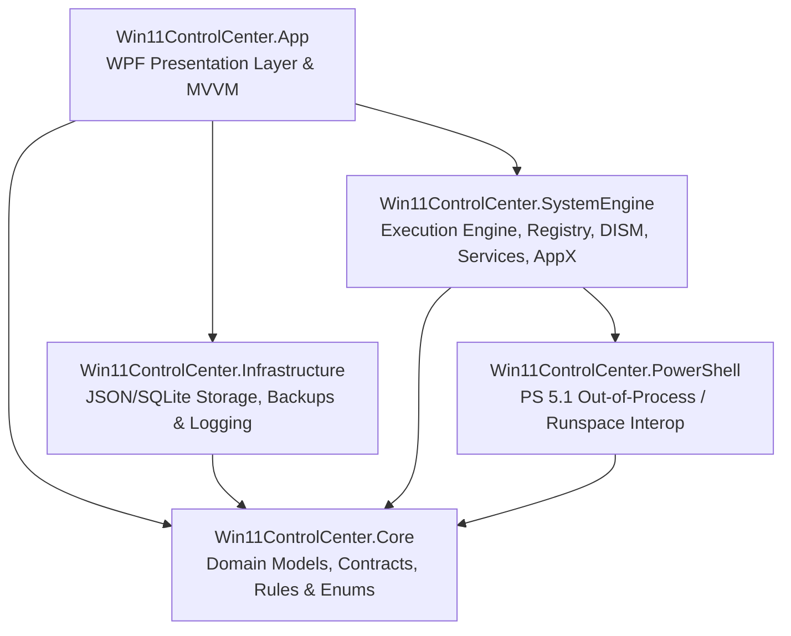

# Win11 Control Center — Architecture Specification

## 1. Executive Overview

**Win11 Control Center** is a modular, production-grade Windows 11 management and optimization desktop application engineered in C# and .NET 10 LTS with WPF, MVVM architecture, and a hardened Windows administrative execution engine.

Unlike ad-hoc debloater scripts, Win11 Control Center follows strict systems engineering principles:
1. **Safety before performance**: System stability and integrity take precedence over aggressive tuning.
2. **Reversibility before convenience**: Every mutable action must capture a pre-change state and supply an automated rollback mechanism whenever technically feasible.
3. **Transparency before automation**: No silent changes. All operations produce a structured, human-readable plan prior to execution.
4. **User consent before modification**: Explicit user approval is required for all state transitions.
5. **Measurable optimization**: All reported metrics and optimization candidates are grounded in genuine Windows APIs.
6. **Modular architecture**: Separation of presentation, domain logic, infrastructure persistence, low-level system interop, and PowerShell management.

---

## 2. High-Level System Architecture

The solution is divided into strictly decoupled layers:

### Layer Responsibilities

1. **`Win11ControlCenter.Core`**:
   - Pure domain models (`ApplicationPackage`, `WindowsServiceItem`, `StartupEntry`, `PrivacyTweak`, `OperationPlan`, `OperationItem`, `SystemMetrics`).
   - Domain rules (Protected application allow-lists, Core service preservation rules, Safety validations).
   - Abstractions and interfaces (`IOperationExecutor`, `ISystemDiscoveryService`, `IPackageManager`, `IServiceManager`, `IStartupManager`, `IPrivacyManager`, `ICleanupManager`, `IRestoreManager`, `ILoggingService`).
   - Zero external third-party dependencies outside standard .NET primitives.

2. **`Win11ControlCenter.Infrastructure`**:
   - Local JSON/SQLite storage for preferences, profiles, operation history, and backups.
   - Structured JSON logging and audit trail persistence.
   - Backup folder management (`Backups/YYYY-MM-DD_HH-mm-ss/`).
   - Cryptographic validation of stored profiles and catalog files.

3. **`Win11ControlCenter.SystemEngine`**:
   - Direct Windows API interop (Registry, Service Control Manager via `System.ServiceProcess`, AppX / MSIX APIs via COM / Windows SDK, Performance Counters, DISM).
   - The **Safe Execution Engine** implementing the 10-step operation workflow.
   - Dry-run calculation, precondition checks, postcondition verification.
   - Safe elevation / UAC boundaries.

4. **`Win11ControlCenter.PowerShell`**:
   - Windows PowerShell 5.1 hosted runspaces or out-of-process isolation for operations requiring PowerShell cmdlets (e.g., `Get-AppxPackage`, `Remove-AppxPackage`, `Get-AppxProvisionedPackage`, `Remove-AppxProvisionedPackage`, Task Scheduler).
   - Strictly parameterized execution with allow-listed scripts and commands. **Never** allows arbitrary script concatenation or unvetted JSON execution.

5. **`Win11ControlCenter.App`**:
   - WPF application targeting Windows 10/11 x64.
   - MVVM architecture with `CommunityToolkit.Mvvm`.
   - Dependency Injection using `Microsoft.Extensions.DependencyInjection`.
   - Fluent Windows 11 styling (Dark/Light mode, mica/acrylic cues, modern navigation sidebar, cards, responsive tables).
   - No business or system manipulation logic in code-behind or ViewModels.

---

## 3. The 10-Step Safe Execution Engine

Every state-modifying action in Win11 Control Center passes through a unified execution pipeline:

### Pipeline Definitions:
1. **Discover**: Read-only capture of current Windows state (registry values, installed package status, service startup type, etc.).
2. **Analyze**: Verify system compatibility, policy restrictions (MDM/GPO/Domain), edition support, and safety rules. Reject protected components.
3. **Generate Plan**: Create an immutable `OperationPlan` containing discrete `OperationItem` objects with estimated risk, prerequisites, and expected outcome.
4. **Preview**: Render the plan to the user with exact keys, paths, and consequences clearly highlighted.
5. **Backup**: Persist pre-change values (original registry values, service configurations, package identifiers) to the backup repository before any mutation occurs.
6. **User Approval**: Explicit consent gate. In dry-run mode, execution halts here and reports simulated outcomes.
7. **Execute**: Sequentially dispatch operations using strongly-typed, allow-listed execution handlers.
8. **Verify**: Query the system state post-execution to confirm whether the intended change took effect.
9. **Log**: Record the operation identifier, initial state, target state, result code, errors, and timestamps in the local audit log.
10. **Restore Ready**: Index the generated backup in the Restore Center for one-click rollback.

---

## 4. Safety and Boundary Rules

- **Administrator Privileges**: Non-elevated execution by default. Elevated helper or JIT UAC elevation requested only when executing operations requiring `LocalMachine` or driver/service alterations.
- **Protected Components**: A hardcoded set of core Windows components, shell packages, and dependencies that cannot be disabled or uninstalled under any circumstance.
- **Core Services Preservation**: SCM operations strictly forbid disabling or stopping core infrastructure services (RPC, EventLog, CryptSvc, DnsCache, Winmgmt, etc.).
- **Zero Arbitrary Execution**: Scripts and operations are selected from an immutable compile-time catalog. Input parameters are strictly validated against regex and allowed bounds.
- **Enterprise / Domain Detection**: Detects domain membership and GPO/MDM flags; refuses to overwrite managed enterprise policies.

---

## 5. Data Flow and Storage

All data stays 100% local on the user's machine:
- User Preferences: `%LocalAppData%\Win11ControlCenter\settings.json`
- Operation Logs: `%LocalAppData%\Win11ControlCenter\Logs\audit.jsonl`
- Recovery Snapshots: `%LocalAppData%\Win11ControlCenter\Backups\{Timestamp}\`
- Custom Presets: `%LocalAppData%\Win11ControlCenter\Profiles\`

No background telemetry, analytics, or external network connections are made during standard system operations.

